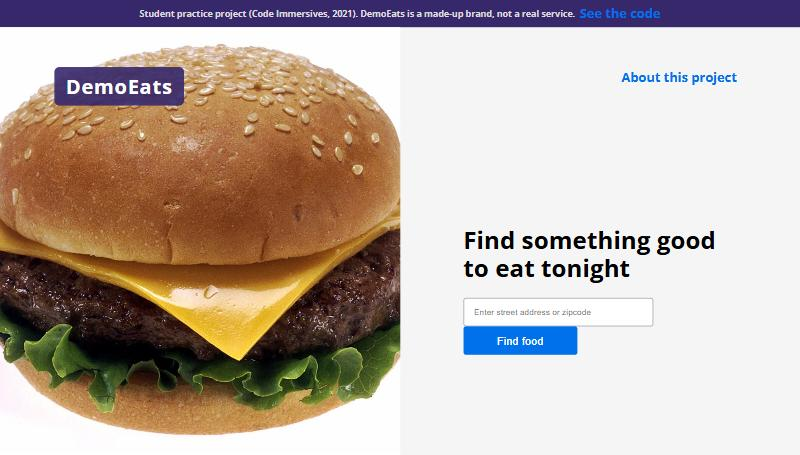

# DemoEats — Food-Delivery Homepage Layout (HTML & CSS)

### 🔗 Live site: **[rickrieger.github.io/gitHubCopyCat](https://rickrieger.github.io/gitHubCopyCat/)**



A front-end layout exercise from the **Code Immersives** web development bootcamp in New York City (**February 24, 2021**). The task was to rebuild the layout of a real food-delivery homepage from scratch with **HTML and CSS Flexbox**: a split hero section, a three-column feature row, an image-and-text section and a multi-column footer. This is my own repo, not a fork of an assignment.

**DemoEats is a made-up brand.** The original 2021 version copied the real company's logo, text and images. In 2026 I rebranded it so it could be published without being mistaken for the real site. A banner at the top of the page says it's a student project.

**Built with:** HTML5 and CSS3 (Flexbox), Google Fonts (Open Sans) and Font Awesome icons. No JavaScript, no frameworks.

---

## Contents

- [Page layout](#page-layout)
- [How the layout works](#how-the-layout-works)
- [Run it locally](#run-it-locally)
- [Deployment](#deployment)
- [Cleanup log (November 2026)](#cleanup-log-november-2026)
- [Image credits](#image-credits)

---

## Page layout

| Section | HTML id | Layout |
|---|---|---|
| Banner | `#header` | Full-width strip, text centered with Flexbox |
| Hero | `#food` → `#burger` + `#findFood` | Two halves side by side: a photo with the logo on top, and a headline with a search box |
| Feature row | `#qualities` → `.items` | Three icon-and-text columns, centered |
| Pickup or delivery | `#pickupDelivery` | Text on the left, photo on the right |
| About | `#about` | Heading and paragraph on a grey band |
| Footer | `#footer` → `#section1-footer` | Four columns of links and buttons (`flex: 0 0 25%`) |

The search box, links and buttons are placeholders. Nothing is sent anywhere.

## How the layout works

**Flexbox everywhere.** Every section uses `display: flex`. The hero puts its two halves in a row:

```css
#food {
  display: flex;          /* children sit side by side */
  height: 94vh;           /* nearly a full screen tall */
}
#burger   { width: 50%; position: relative; }   /* left: photo + logo */
#findFood { flex: 0 0 50%; max-width: 50%; }    /* right: headline + search */
```

**Image that fills its box.** The hero photo uses `position: absolute` to fill the left half, and `object-fit: cover` crops it to fit without stretching:

```css
#burger-img {
  position: absolute;
  top: 0; left: 0;
  width: 100%; height: 100%;
  object-fit: cover;
}
```

**Logo on top of the photo.** The logo is also absolutely positioned inside `#burger` (which is `position: relative`), so it sits in the top-left corner over the image.

**Footer columns.** `flex-wrap: wrap` with each column at `flex: 0 0 25%` gives four equal columns that wrap if there isn't room.

**Phones.** Below 760px wide, a media query switches the side-by-side sections to `flex-direction: column` so they stack (added in the 2026 cleanup).

## Run it locally

No build step:

```bash
git clone https://github.com/RickRieger/gitHubCopyCat.git
cd gitHubCopyCat
# open index.html in a browser
```

## Deployment

Hosted on **GitHub Pages** from the root of the `main` branch (turned on November 2026). Every push to `main` redeploys the site within a minute or two.

---

## Cleanup log (November 2026)

All changes below were made on **2026-11-23** on the branch `rebrand-and-deploy`, checked in a browser at desktop (1280px) and phone (375px) widths, and merged into `main`. Each is its own commit.

### 1. Moved the page to the repo root and removed editor files

**Why:** the page lived in a `grubHub/` subfolder, which would have made the live address `/gitHubCopyCat/grubHub/`. Two identical VS Code workspace files (`*.code-workspace`) were also committed; they're editor settings, not part of the site.

```
Before                                After
grubHub/                              index.html
├── index.html                        style.css
├── style.css                         assets/
├── assets/                           docs/screenshot.jpg
├── grubHub.code-workspace            README.md
└── workspace.code-workspace
```

### 2. Rebranded as the fictional "DemoEats" so the page can be published

**Why:** the original was a close copy of a real company's homepage: its logo, marketing text, photos and illustrations, plus a "Sign in" link and an email sign-up form. Published as-is, it could be mistaken for the real site and would reuse someone else's trademark and artwork. The layout and CSS, the actual point of the exercise, are kept. Everything brand-specific was replaced:

| | Before | After |
|---|---|---|
| Logo | The company's logo image | A text logo, **DemoEats**, styled in CSS |
| Text | The company's marketing copy | Rewritten in my own words, plus an "About this project" section |
| Images | The company's photos and illustrations | Public-domain / CC0 photos from Wikimedia Commons (see [Image credits](#image-credits)) and Font Awesome icons |
| Sign-in | "Get Perks in the app" and "Sign in" links | A single "About this project" link |
| Sign-up form | Email and zip code form | Removed; the footer column describes the demo instead |
| Banner | The company's health-and-safety notice | "Student practice project (Code Immersives, 2021). DemoEats is a made-up brand, not a real service." |
| Page title | `Document` | `DemoEats: a student layout project` |

```html
<!-- Before -->

...
<a href="#">Get Perks in the app</a>&nbsp&nbsp &nbsp
<a href="#">Sign in</a>

<!-- After -->
<span id="logo-img">DemoEats</span>
...
<a href="#about">About this project</a>
```

The same commit also fixed two typos in the footer buttons ("resturants" → "restaurants", "crperate" → "corporate") and replaced the two external links that had stopped working (item 3).

### 3. Fixed the dead font and icon links

**Why:** the page loaded its bold font from `allfont.net` (now returns **404**) and its icons from a Font Awesome "kit" (now returns **403**), so the icons and font never appeared. Both now come from stable sources.

```html
<!-- Before -->
<link href="https://allfont.net/allfont.css?fonts=open-sans-bold" rel="stylesheet" type="text/css" />
<script src='https://kit.fontawesome.com/a076d05399.js'></script>

<!-- After -->
<link href="https://fonts.googleapis.com/css2?family=Open+Sans:wght@400;600;700&display=swap" rel="stylesheet" />
<link rel="stylesheet" href="https://cdnjs.cloudflare.com/ajax/libs/font-awesome/5.15.4/css/all.min.css" />
```

### 4. Fixed the CSS: real font names, sideways scrolling, invalid rules and sizing

**Why:**
- **Fonts:** the CSS asked for `graphik`, `grubhubsans-bold` and `'Open Sans Bold'`, which were never loaded, so the browser fell back to a default font. All now use `'Open Sans'`, with `font-weight: 700` for bold.
- **Sideways scroll:** many sections used `width: 100vw` (or `50vw`). `vw` includes the vertical scrollbar, so those sections were slightly *wider* than the page, causing a horizontal scrollbar. Switched to `100%` / `50%`.
- **Three invalid rules** that browsers silently ignored:

  ```css
  /* Before */
  #perksapp > `div{ ... }              /* stray backtick, wrong case: matched nothing */
  display:inline-ß6block;               /* garbled text */
  border-radius: 1px solid #8f8fa1;    /* a border value inside border-radius */

  /* After */
  #perksApp > div { ... }
  display: inline-block;
  border: 1px solid #8f8fa1;
  border-radius: 4px;
  ```
- **Sizing:** the "pickup or delivery" photo is now capped to its column (`max-width: 100%`), and the About band grows to fit its text (`min-height` instead of a fixed `height`). The footer was `height: 150vh`, about 1,200px of mostly empty blue, and now sizes to its content.

### 5. Added a phone layout

**Why:** the original only worked on wide screens. On a phone, the two hero halves stayed side by side and text overlapped. A media query now stacks the sections below 760px wide. The desktop layout is unchanged.

```css
@media (max-width: 760px) {
  #food, #qualities, #pickupDelivery, #about {
    flex-direction: column;   /* stack instead of side by side */
    height: auto;
  }
  #burger   { width: 100%; height: 40vh; }
  #findFood { width: 100%; max-width: 100%; padding: 24px; }
  /* ...full-width search box, smaller headings, one footer column per row */
}
```

Checked at 375px wide: no horizontal scroll and nothing overlapping.

### 6. Deployed to GitHub Pages and added this README

The repo had no README and had never been published.

---

## Image credits

- `assets/hero-burger.jpg`: ["Cheeseburger"](https://commons.wikimedia.org/wiki/File:Cheeseburger.jpg), public domain, via Wikimedia Commons.
- `assets/friends-eating.jpg`: ["Friends eating lunch in diner (Unsplash)"](https://commons.wikimedia.org/wiki/File:Friends_eating_lunch_in_diner_(Unsplash).jpg), CC0, via Wikimedia Commons.
- Icons: [Font Awesome Free](https://fontawesome.com/) 5.15.4.
